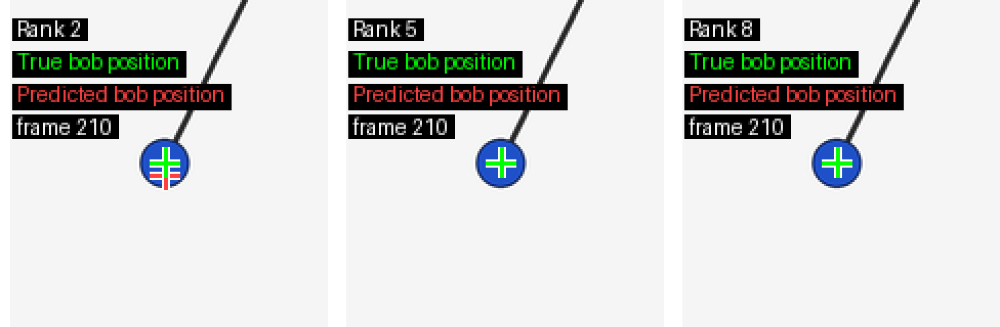

# Data Science Topics

This repository contains notebook-centered explorations of mathematics, data science, geospatial analysis, and Python programming.

Many folders are built around a Jupyter notebook that combines conceptual explanation with hands-on implementation. The emphasis is on understanding the method, inspecting the implementation, visualizing the results, and connecting the mathematics to practical examples.

This repository is less deployment-focused than my main machine learning portfolio work in [`MLProjects`](https://github.com/bodle720/MLProjects). It is intended to show mathematical intuition, scientific analysis, implementation, and practical Python/data-science work. My [personal website](https://bodle720.github.io/) provides an overview of my broader technical work.

## Geospatial Analysis

### Anchorage Through the Seasons

A cloud-native geospatial case study exploring seasonal vegetation greenness and snow and ice across approximately 4,359 km² of mapped municipal land in Anchorage, Alaska. Eight selected Sentinel-2 acquisitions from 2025 are analyzed across four fixed geographic study regions.

The project combines QGIS, GeoPandas, Shapely, Rasterio, STAC imagery discovery, Cloud Optimized GeoTIFFs (COGs), and an AWS S3 remote raster access demonstration. It uses NDVI and NDSI spectral indices, scene classification masks, and explicit observation-coverage statistics to interpret seasonal patterns and their limitations.

The notebook includes maps, statistical charts, mathematical explanations, and executable examples using the published regional statistics. The repository also includes the processing scripts, geographic inputs, acquisition records, and scientific methodology manifests. Large satellite imagery and intermediate raster products are intentionally excluded. AI assisted extensively with code development; I directed the analysis, executed the workflow, reviewed the results, and made the scientific and presentation decisions.

Start here:

* [Anchorage project README](Anchorage_Seasons/README.md)
* [Anchorage Seasons notebook](Anchorage_Seasons/Anchorage_Seasons.ipynb)
* [Processing scripts](Anchorage_Seasons/scripts/)
* [Reproducibility documentation](Anchorage_Seasons/reproducibility/README.md)
* [Regional statistics CSV](Anchorage_Seasons/results/anchorage_2025_seasonal_regional_statistics.csv)

## Applied Mathematics and Data Science

### Dynamic Mode Decomposition

DMD is applied to a synthetic pendulum video to study how state representation affects reconstruction and forecasting. Full-frame pixel DMD recovers meaningful spatial modes and near-correct oscillation frequencies, but its important motion modes are strongly damped, causing reconstruction to decay toward the mean frame. A lower-dimensional delay-coordinate model built from the pendulum bob trajectory recovers the true oscillation and forecasts the motion much more accurately.

Start here:

* [DMD project README](DMD/README.md)
* [DMD pendulum notebook](DMD/DMD_pendulum_video.ipynb)
* [DMD background notes](DMD/docs/DMD_Background/README.md)

### Dimensionality Reduction and Signal Separation

| Topic | Main Artifact | Focus |
| --- | --- | --- |
| Linear PCA | [pca_linear_oscillation_system.ipynb](PCA_linear/pca_linear_oscillation_system.ipynb) | Linear PCA on a synthetic oscillating dynamical system, including covariance/eigenvector intuition, explained variance, loadings, and recovery of low-dimensional structure from noisy high-dimensional observations. |
| Kernel PCA | [pca_kernel.ipynb](PCA_kernel/pca_kernel.ipynb) | Nonlinear dimensionality reduction using kernel PCA, including RBF-kernel intuition, kernel centering, eigen-decomposition, and comparison against ordinary PCA. |
| Robust PCA | [PCA_robust_handwritten_digits_noise.ipynb](PCA_robust/PCA_robust_handwritten_digits_noise.ipynb) | Robust PCA on corrupted handwritten digit images, separating low-rank structure from sparse noise and using cleaned representations for downstream classification. |
| Sparse PCA | [PCA_sparse_handwritten_digits.ipynb](PCA_sparse/PCA_sparse_handwritten_digits.ipynb) | Sparse PCA on handwritten digit images, emphasizing sparse loadings, interpretability, feature visualization, and image reconstruction. |
| ICA | [ica_on_imagery.ipynb](ICA/ica_on_imagery.ipynb) | Independent Component Analysis / blind-source separation on imagery, using artificial image mixing and matrix methods to recover approximate source images. |

Together, these notebooks demonstrate dimensionality reduction, eigenvalue methods, signal separation, visual intuition, and the relationship between mathematical structure and practical data analysis.

## Practical Python and API Work

These folders are smaller practical examples rather than modeling notebooks:

| Topic | Main Artifact | Focus |
| --- | --- | --- |
| Interactive Brokers API | [IBKR](IBKR/) | Real-world API integration example using the Interactive Brokers API, focused on connection handling, asynchronous callbacks, market-data retrieval, and `pandas` data organization. |
| Python Multiprocessing | [Python_Multiprocessing](Python_Multiprocessing/) | Practical Python multiprocessing example using `multiprocessing.Pool`, `imap`, `tqdm`, chunk sizing, and ordered result collection. |

They are included because practical data work often requires more than modeling: it also requires API integration, scripting, data handling, and performance-aware Python code.

## Notes

Some notebooks intentionally take the "long route" instead of only calling a high-level library function. This is deliberate. The goal is to make the underlying method easier to inspect, explain, and reason about.

Not every folder is meant to be a polished application. This repository is a collection of focused explorations that demonstrate mathematical understanding, scientific analysis, practical implementation, and curiosity across data science and Python programming topics.

Social Preview photo by <a href="https://unsplash.com/@steve_j?utm_source=unsplash&utm_medium=referral&utm_content=creditCopyText">Steve A Johnson</a> on <a href="https://unsplash.com/photos/a-group-of-white-boxes-with-numbers-on-them-QaM0dr1xN4M?utm_source=unsplash&utm_medium=referral&utm_content=creditCopyText">Unsplash</a>
